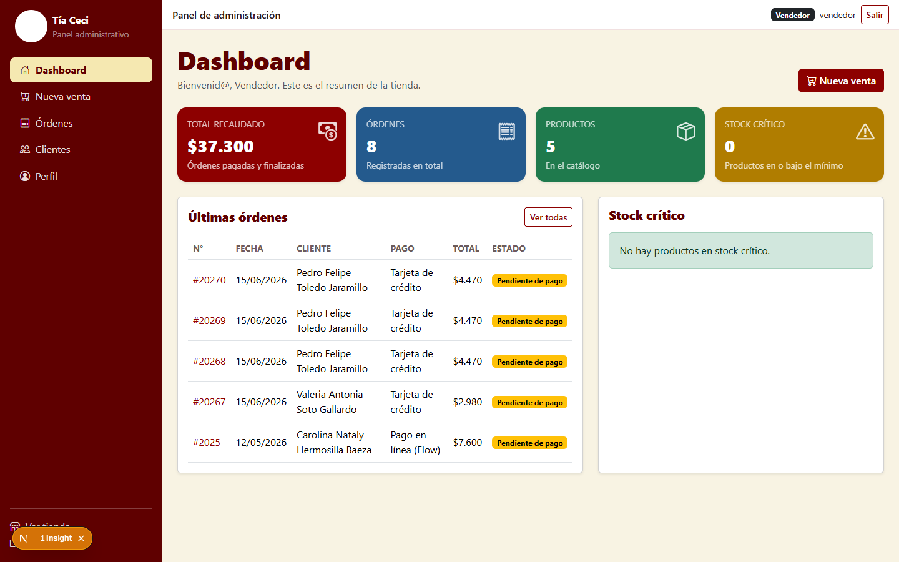
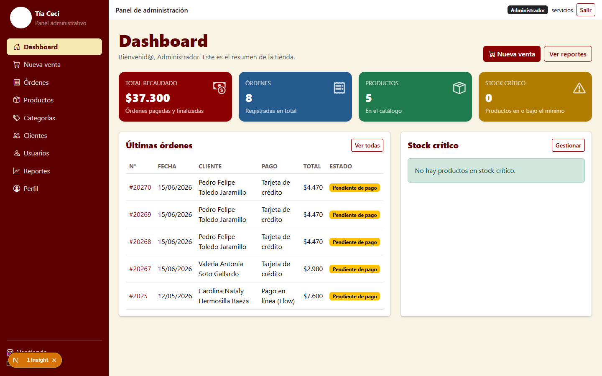
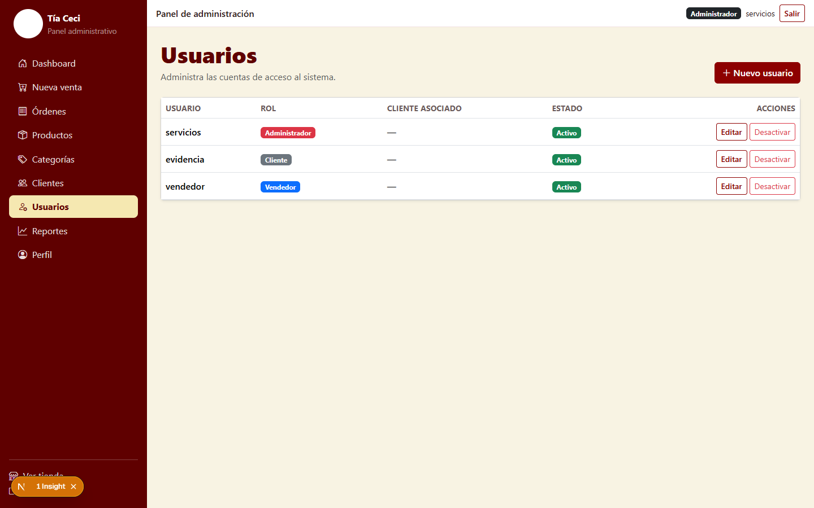
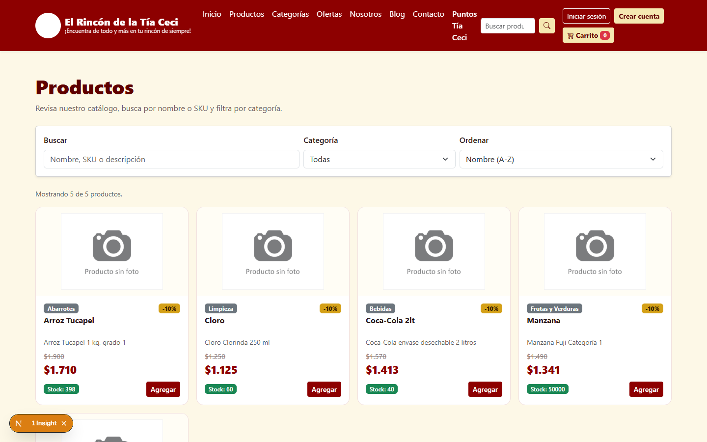

# Guía de evaluación

**Evaluación Parcial N° 3 — DSY1104 Desarrollo Fullstack II (40%)**
**Proyecto:** El Rincón de la Tía Ceci — tienda online y punto de venta
**Integrantes:** Carolina Nataly Hermosilla Baeza · Pedro Felipe Toledo Jaramillo

---

## 1. Qué cambió respecto de la Evaluación 2

La Evaluación 2 entregó una tienda funcionando contra una **API simulada**
(`json-server` con un archivo `db.json`). En esta entrega se reemplazó esa
simulación por el **backend real de microservicios VentaRápida** y se agregó
autenticación con roles y sesión en el frontend.

| | Evaluación 2 | Evaluación 3 (ahora) |
|---|---|---|
| Origen de los datos | `db.json` en el navegador | MySQL, 10 bases `bd_*` |
| Comunicación | `json-server` en el puerto 4000 | API Gateway en el puerto 4425 |
| Login | comparaba texto plano en el navegador | valida en el backend con BCrypt |
| Sesión | objeto en `localStorage` | objeto + **token JWT** con el rol |
| Permisos | solo visuales | visuales **y** rechazados por el servidor |
| Ventas | las armaba el navegador | las procesa `service-ventas` |
| Pruebas | 33 unitarias | 33 unitarias + 12 de navegador + 9 de autorización |

---

## 2. Cómo se levanta todo (para la demostración)

Haz **doble clic** en `arrancar-todo.cmd`, en la carpeta del proyecto.

El script abre tres ventanas en orden y va comprobando cada componente:

1. **MySQL** — comprueba el puerto 3306.
2. **Backend** — lanza los 11 microservicios y espera a que **todos** abran su
   puerto, mostrando una tabla con cada uno.
3. **Frontend** — arranca Next.js y comprueba el puerto 3000.

Al terminar muestra las direcciones y los usuarios. Si algo falla, dice cuál y
dónde está el registro.

Para apagar todo: doble clic en `apagar-todo.cmd`.

También se pueden usar desde una terminal:

```powershell
.\arrancar-todo.ps1          # levanta todo
.\arrancar-todo.ps1 -SoloEstado   # solo informa qué está corriendo
.\apagar-todo.ps1            # apaga todo
```

### Direcciones y usuarios

| Qué | Dirección |
|---|---|
| Tienda | <http://localhost:3000> |
| Panel de administración | <http://localhost:3000/admin> |
| **Swagger (10 servicios)** | <http://localhost:4425/swagger-ui.html> |

| Usuario | Contraseña | Rol |
|---|---|---|
| `servicios` | `Servicios123` | Administrador |
| `vendedor` | `vendedor123` | Vendedor |

---

## 3. Situación evaluativa 1: entrega por encargo (40 %)

### IE3.1.1 — Backend con base de datos, lógica de negocio y modelos (8 %)

**Qué se pide:** una aplicación backend conectada a una base de datos, con
lógica de negocio y modelos de datos según los requisitos del cliente.

**Qué hay:** 11 proyectos Spring Boot independientes, cada uno con su propia
base de datos MySQL y sus entidades JPA.

**Dónde encontrarlo:**

| Elemento | Ubicación |
|---|---|
| Modelos de datos (entidades JPA) | `ventarapida-backend/service-*/src/main/java/**/model/` — por ejemplo `Producto.java`, `Categoria.java`, `Orden.java`, `Detalle.java`, `Stock.java`, `Usuario.java`, `Rol.java` |
| Conexión a la base de datos | `service-*/src/main/resources/application.properties` (`spring.datasource.url=jdbc:mysql://localhost:3306/bd_*`) |
| Lógica de negocio de una venta | `service-ventas/.../service/VentaService.java` → `procesarVenta()` |
| Lógica de inventario | `service-inventario/.../service/InventarioService.java` → `nuevoMovimiento()` |
| Creación de la base | `127_0_0_1.sql` (crea las 10 bases y carga los datos) |

**Las 10 bases:** `bd_catalogo`, `bd_cliente`, `bd_factura`, `bd_inventario`,
`bd_notificaciones`, `bd_pago`, `bd_proveedores`, `bd_reportes`, `bd_usuario`,
`bd_venta`.

**Cómo demostrarlo:**

1. Abrir Swagger y mostrar que cada servicio tiene sus endpoints.
2. Ejecutar en MySQL:
   ```sql
   SHOW DATABASES LIKE 'bd_%';
   SELECT * FROM bd_catalogo.producto;
   SELECT * FROM bd_venta.orden;
   ```
3. Explicar `procesarVenta()`: pide el precio al catálogo, calcula el total,
   registra la salida de inventario, manda a procesar el pago y guarda la orden.

**Punto fuerte para mencionar:** la lógica de la venta **no** está en el
navegador. El navegador solo envía los productos y las cantidades; el precio lo
pone el backend desde su catálogo, así que no se puede manipular desde el
cliente.

---

### IE3.2.1 — API REST con Spring Boot y Swagger, operaciones CRUD (8 %)

**Qué se pide:** servicios de API REST con endpoints para leer, crear, actualizar
y eliminar, documentados y visibles en Swagger.

**Dónde encontrarlo:** controladores en
`ventarapida-backend/service-*/src/main/java/**/controller/`.

**Swagger:** <http://localhost:4425/swagger-ui.html>
En la lista de arriba aparecen los **10 servicios**:

Servicio Catálogo · Servicio Clientes · Servicio Facturación · Servicio
Inventario · Servicio Notificaciones · Servicio Pagos · Servicio Proveedores ·
Servicio Reportes · Servicio Usuario Autenticación · Servicio Ventas

**CRUD disponible (los principales):**

| Recurso | Leer | Crear | Actualizar | Eliminar |
|---|:---:|:---:|:---:|:---:|
| Categorías | Sí | Sí | Sí | Sí |
| Productos | Sí | Sí | Sí | Sí |
| Clientes | Sí | Sí | Sí (PATCH) | — |
| Stock | Sí | Sí | Sí | Sí |
| Órdenes | Sí | Sí | Sí (PATCH estado) | — |
| Usuarios | Sí | Sí | Sí | — |
| Notificaciones | Sí | Sí | Sí | Sí |
| Proveedores | Sí | Sí | Sí (PATCH) | — |
| Métodos de pago | Sí | Sí | Sí | — |

**Cómo demostrarlo:** en Swagger, abrir *Servicio Catálogo* → `GET /api/v1/categorias`
→ *Try it out* → *Execute* (no requiere token porque es lectura pública).
Luego mostrar lo mismo hecho desde el panel: crear un producto en
`/admin/productos`.

> **Nota honesta:** los endpoints de stock, de administración de usuarios y el
> cambio de estado de una orden **se agregaron en esta entrega**, porque el panel
> los necesitaba y no existían. Están identificados en el Documento de
> Integración, sección 10.

---

### IE3.2.2 — Integración entre backend y frontend por API REST (6 %)

**Qué se pide:** que los servicios de backend y frontend se comuniquen
correctamente, y justificar el flujo de datos.

**Dónde encontrarlo:**

| Elemento | Ubicación |
|---|---|
| Dirección del backend | `lib/constantes.js` → `API_URL = "http://localhost:4425/api/v1"` |
| **Capa adaptadora** | `lib/api.js` — todas las llamadas pasan por aquí |
| Registro de ventas | `lib/ventas.js` |
| Autenticación | `lib/sesion.js` |

**Cómo funciona:** el navegador nunca habla con los microservicios; siempre pasa
por el **API Gateway**, que es el único punto de entrada. Eso deja el control de
acceso y el CORS en un solo lugar.

`lib/api.js` cumple dos funciones:

1. **Agrega el token** `Authorization: Bearer <jwt>` a cada petición.
2. **Traduce los datos**, porque el backend nombra distinto: `pNombre` del backend
   pasa a `pnombre` en el frontend, `metodoPago.id` a `idMetodoPago`, etc.

**Cómo demostrarlo:**

1. Abrir DevTools (F12) → pestaña **Network** → filtro `Fetch/XHR`.
2. Navegar a `/productos`: se ven las llamadas a `localhost:4425/api/v1/productos`.
3. Iniciar sesión y repetir: ahora cada petición lleva la cabecera
   `Authorization: Bearer eyJ...`.
4. Registrar una venta en *Nueva venta* y mostrar que la orden aparece en
   `/admin/ordenes` y que el **stock bajó**.

**Flujo de una venta** (para explicar):

```
Navegador -> POST /api/v1/ordenes { numeroOrden, idCliente, idMetodoPago,
                                    detalles: [{ idProducto, cantidad }] }
              |
              v
        API Gateway (valida token y rol)
              |
              v
        service-ventas -> pide precio a service-catalogo
                          -> registra "Salida" en service-inventario
                          -> pide procesar el pago a service-pagos
                          -> guarda la orden en bd_venta
              |
              v
Navegador <- { id, numeroOrden, montoTotal, status }
```

---

### IE3.3.1 — Autenticación con roles y tokens JWT en el backend (6 %)

**Qué se pide:** autenticación de usuarios con roles, usando tokens JWT, para que
solo los usuarios autorizados accedan a ciertos recursos.

**Dónde encontrarlo:**

| Elemento | Ubicación |
|---|---|
| Entidad con rol | `service-auth/.../model/Usuario.java` (campo `rol`, `@ManyToOne`) y `Rol.java` |
| Generación del token | `service-auth/.../service/JwtService.java` |
| Login y validación de clave | `service-auth/.../service/AuthService.java` (BCrypt) |
| **Validación de token y roles** | `api-gateway/.../filter/AuthenticationFilter.java` |
| Cómo se guarda la clave | BCrypt, nunca en texto plano |

**Qué se corrigió:** el backend ya emitía tokens, pero `AuthService` llamaba
`generarToken(username, List.of())`, o sea **siempre con los roles vacíos**, y la
entidad `Usuario` no tenía relación con `Rol`. Se agregó la relación, se envió el
rol real dentro del token y el gateway pasó a exigirlo.

**Cómo demostrarlo:**

1. Iniciar sesión y mostrar el token en DevTools → Application → Local Storage →
   clave `sesion`.
2. Copiar el token y pegarlo en <https://jwt.io> (o mostrar el contenido). Se ve:
   ```json
   { "sub": "servicios", "rol": ["Administrador"], "iat": ..., "exp": ... }
   ```
3. Demostrar que el servidor **rechaza** aunque el frontend se salte: con el token
   del vendedor, pedir facturas:

   ```powershell
   $token = (Invoke-WebRequest -Uri 'http://localhost:4425/api/v1/auth/login' -Method POST `
     -Body '{"nombreUsuario":"vendedor","contrasena":"vendedor123"}' `
     -ContentType 'application/json' -UseBasicParsing).Content.Trim('"')

   # 403: el vendedor no puede ver facturas
   Invoke-WebRequest -Uri 'http://localhost:4425/api/v1/facturas' `
     -Headers @{ Authorization = "Bearer $token" }
   ```

   Y lo mismo con el token del administrador: responde 200.

4. Mostrar que sin token: `/api/v1/clientes` responde **401**.

---

### IE3.3.2 — Gestión de sesión en el frontend, con persistencia (6 %)

**Qué se pide:** un sistema de sesiones que mantenga el estado de autenticación de
forma segura y que la sesión persista aunque se recargue la página.

**Dónde encontrarlo:** `lib/sesion.js` y `components/AdminShell.js`.

**Cómo funciona:** al iniciar sesión se guarda un objeto en `localStorage`, bajo la
clave `sesion`, con el nombre, el rol y el **token**:

```json
{ "nombreUsuario": "servicios", "rol": "Administrador", "token": "eyJhbGci..." }
```

- `obtenerSesion()` lo lee y devuelve `null` si está incompleto.
- `obtenerToken()` entrega solo el token, que `lib/api.js` usa en cada petición.
- `cerrarSesion()` lo borra y avisa con el evento `sesion-actualizada`.

**Cómo demostrarlo:**

1. Iniciar sesión como administrador → llega a `/admin`.
2. **Recargar con F5** → sigue dentro, en `/admin`.
3. Abrir DevTools → Application → Local Storage → mostrar la clave `sesion` con el
   token.
4. Cerrar el navegador y abrirlo de nuevo: la sesión sigue.
5. Pulsar *Salir* → la clave desaparece y vuelve a la tienda.

---

### IE3.3.3 — Restricciones de acceso a funcionalidades en el frontend (6 %)

**Qué se pide:** que las interfaces y acciones sean accesibles solo para usuarios
con los permisos adecuados.

**Dónde encontrarlo:**

| Elemento | Ubicación |
|---|---|
| Menú según el rol | `components/AdminSidebar.js` |
| Protección de rutas del panel | `components/AdminShell.js` (lista `RUTAS_SOLO_ADMIN`) |
| Reglas de rol | `lib/sesion.js` (`esAdministrador`, `puedeEntrarAlAdmin`, `rutaInicioPorRol`) |
| Doble control en el servidor | `AuthenticationFilter.java` del gateway |

**Ejemplo de interfaces restringidas:** con el rol **Vendedor**, el menú no
muestra Productos, Categorías, Clientes, Usuarios, Reportes ni Perfil. Si escribe
`/admin/productos` en la barra de direcciones, la aplicación lo devuelve a
`/admin`. Y si intentara la operación directamente contra la API, el gateway
responde **403**.

**Cómo demostrarlo:**

1. Entrar como `vendedor` / `vendedor123`.
2. Mostrar el menú reducido (5 opciones).
3. Escribir a mano `http://localhost:3000/admin/productos` → vuelve a `/admin`.
4. Salir y entrar como `servicios` → ahora el menú está completo.



*Menú con el rol Vendedor: solo lo necesario para vender.*


*Al entrar a una sección de administrador, la aplicación devuelve al dashboard.*

---

## 4. Situación evaluativa 2: presentación individual (60 %)

Esta parte se evalúa por persona. Para cada indicador, qué mostrar y qué explicar.

### IE3.1.2 — Describir el backend con base de datos (12 %)

**Mostrar:** Swagger y las bases `bd_*`.

**Explicar:**
- Son 11 microservicios Spring Boot, cada uno con **su propia base de datos**;
  no comparten tablas.
- Se comunican entre ellos por HTTP con `WebClient` a través del gateway, que
  además les inyecta un token de servicio.
- Cada servicio tiene sus entidades JPA, sus repositorios y su lógica de negocio.
- Ejemplo concreto: al crear una orden, `service-ventas` consulta el precio a
  `service-catalogo`, descuenta en `service-inventario` y cobra en
  `service-pagos`.

### IE3.2.3 — Explicar Spring Boot y Swagger (12 %)

**Mostrar:** <http://localhost:4425/swagger-ui.html>, desplegable con los 10 servicios.

**Explicar:**
- Cada `@RestController` con `@RequestMapping("api/v1/...")` expone los endpoints.
- SpringDoc genera el OpenAPI automáticamente; el gateway **agrupa** los 10
  documentos en un solo Swagger con el desplegable.
- Las anotaciones `@Operation` y `@ApiResponse` documentan cada endpoint, y los
  `@Schema` de las entidades describen cada campo.
- Demostrar un `GET` y un `POST` en vivo desde *Try it out*.

### IE3.2.4 — Justificar la integración y el flujo de datos (10 %)

**Mostrar:** DevTools → Network mientras se registra una venta.

**Explicar:**
- Todo pasa por el API Gateway: un solo punto de entrada, un solo lugar para el
  CORS y los permisos.
- El frontend nunca calcula el precio de una venta: lo envía y el backend
  responde con el total. Eso evita manipulación desde el navegador.
- La capa `lib/api.js` traduce los nombres de campos para que las 30 pantallas
  no tengan que conocer los detalles del backend.
- Se eliminó un problema real: antes el navegador descontaba el stock y el backend
  también, o sea se descontaba **dos veces**.

### IE3.3.4 — Describir la autenticación con roles y JWT (10 %)

**Mostrar:** el token en `localStorage` y su contenido en jwt.io.

**Explicar:**
- `POST /api/v1/auth/login` valida la contraseña con BCrypt y firma un JWT
  (HS256, vigencia 2 horas) con `sub` (usuario) y `rol`.
- El gateway valida **firma y expiración** en cada petición y además revisa el
  rol contra una política por ruta.
- 401 = sin token o vencido. 403 = token válido pero sin permiso.
- Se corrigió que el token viajaba con la lista de roles vacía.

### IE3.3.5 — Exponer el sistema de sesiones del frontend (8 %)

**Mostrar:** `lib/sesion.js` y una recarga de página.

**Explicar:**
- La sesión completa vive en `localStorage` bajo la clave `sesion`.
- Guardar el **token** junto a los datos del usuario es lo que permite que la
  sesión sobreviva a la recarga y a cerrar el navegador.
- Al montar, `AdminShell` verifica la sesión antes de mostrar el panel; mientras
  revisa muestra *"Verificando sesión..."*, para no expulsar al usuario por error.

### IE3.3.6 — Explicar las restricciones de acceso en el frontend (8 %)

**Mostrar:** el cambio de menú entre vendedor y administrador.

**Explicar:**
- Doble capa: el frontend esconde y redirige; el backend rechaza igual.
- Ocultar no es suficiente por sí solo, porque cualquiera puede escribir la URL o
  llamar la API directamente; por eso el gateway vuelve a validar.
- Las rutas solo de administrador están enumeradas en `RUTAS_SOLO_ADMIN` dentro
  de `components/AdminShell.js`.

---

## 5. Mapa de archivos para orientarse rápido

| Archivo | Qué hace | Indicador |
|---|---|---|
| `lib/constantes.js` | Dirección del backend (`API_URL`) | IE3.2.2 |
| `lib/api.js` | Adaptador: token + traducción de datos | IE3.2.2 |
| `lib/sesion.js` | Sesión y token en `localStorage` | IE3.3.2 |
| `lib/ventas.js` | Registro de ventas delegado al backend | IE3.2.2 |
| `components/AdminShell.js` | Protección de rutas del panel | IE3.3.3 |
| `components/AdminSidebar.js` | Menú según el rol | IE3.3.3 |
| `app/(tienda)/iniciar-sesion/page.js` | Login contra el backend | IE3.3.1 |
| `api-gateway/.../AuthenticationFilter.java` | Valida token y roles | IE3.3.1 / IE3.3.3 |
| `service-auth/.../JwtService.java` | Firma el token | IE3.3.1 |
| `service-auth/.../model/Usuario.java` | Usuario con rol | IE3.3.1 |
| `service-ventas/.../VentaService.java` | Lógica de la venta | IE3.1.1 |
| `arrancar-todo.ps1` | Levanta todo el sistema | Demostración |

---

## 6. Checklist antes de presentar

- [ ] Doble clic en `arrancar-todo.cmd` y esperar el mensaje **"LISTO - SISTEMA COMPLETO ARRIBA"**.
- [ ] Los 11 servicios aparecen en **OK** en la tabla.
- [ ] <http://localhost:3000> carga la tienda con los 5 productos.
- [ ] <http://localhost:4425/swagger-ui.html> abre con los 10 servicios.
- [ ] Login con `servicios` / `Servicios123` entra al panel.
- [ ] Login con `vendedor` / `vendedor123` muestra el menú reducido.
- [ ] DevTools abierto en Network para mostrar las llamadas con el token.
- [ ] Tener a mano el [Manual de Usuario](Manual-Usuario.md) y el
      [Documento de Integración](Documento-Integracion.md) en PDF.
- [ ] Al terminar: doble clic en `apagar-todo.cmd`.

---

## 7. Capturas de apoyo



*El dashboard sumando datos reales del backend: total recaudado, órdenes, productos y stock crítico.*



*Los usuarios viven en `bd_usuario` y cada uno tiene un rol asignado.*



*La tienda pública lee el catálogo del backend sin necesidad de iniciar sesión.*

---

## 8. Verificación que ya está hecha

| Prueba | Resultado |
|---|---|
| Pruebas unitarias del frontend (`npm run test:jsdom`) | **33 de 33** |
| Autorización en el gateway (200 / 401 / 403 por rol) | **9 de 9** |
| Integración en navegador real (login, sesión, roles, catálogo) | **12 de 12** |
| Venta de punta a punta (monto, stock, pago, orden) | correcta: total $3.800 y stock −2 |

El detalle de cada una está en el [Documento de Integración](Documento-Integracion.md), sección 12.
