# Manual de usuario

**Proyecto:** El Rincón de la Tía Ceci — tienda online y punto de venta
**Asignatura:** DSY1104 Desarrollo Fullstack II — Evaluación Parcial N° 3
**Integrantes:** Carolina Nataly Hermosilla Baeza · Pedro Felipe Toledo Jaramillo

---

## 1. ¿Qué es este sistema?

Es la tienda en línea del minimarket **El Rincón de la Tía Ceci** y, al mismo
tiempo, el **punto de venta** que usan los trabajadores del local.

Tiene dos grandes partes:

| Parte | Dirección | Quién la usa |
|---|---|---|
| **Tienda** | `http://localhost:3000` | Cualquier visitante, y los clientes con cuenta |
| **Panel de administración** | `http://localhost:3000/admin` | Administrador y Vendedor |

Todos los datos (productos, clientes, órdenes, pagos, usuarios) se guardan en el
**backend real** de microservicios y en la base de datos MySQL. Ya no hay datos
inventados en el navegador.

---

## 2. Antes de empezar

Para que el sistema funcione tienen que estar corriendo **tres cosas**, en este
orden:

1. **La base de datos MySQL** (puerto 3306).
2. **El backend** (11 servicios, puertos 4419 a 4430, y el gateway en 4425).
3. **El frontend** (puerto 3000).

Si algo de eso falta, las pantallas van a mostrar el aviso
*"No se pudo conectar con la API"*.

```powershell
# 1. Base de datos
F:\wamp64\bin\mysql\mysql8.3.0\bin\mysqld.exe --defaults-file="F:\wamp64\bin\mysql\mysql8.3.0\my.ini" --console

# 2. Backend (en otra ventana)
cd E:\DUOC\2026\2do_semestre\ventarapida-backend
.\iniciar-servicios.ps1

# 3. Frontend (en otra ventana)
cd E:\DUOC\2026\2do_semestre\front_pos
npm run dev
```

Después abrir <http://localhost:3000> en el navegador.

---

## 3. Cómo entrar

Los usuarios viven en la base de datos del backend. Las cuentas para probar son:

| Usuario | Contraseña | Rol | Qué puede hacer |
|---|---|---|---|
| `servicios` | `Servicios123` | Administrador | Todo |
| `vendedor` | `vendedor123` | Vendedor | Vender, ver órdenes, pagos y facturas |
| `evidencia` | (la original) | Cliente | Comprar en la tienda |

> La contraseña debe tener entre 8 y 15 caracteres y se guarda **cifrada** con
> BCrypt en la base de datos; ni el administrador puede leerla.

---

## 4. La tienda (visitante)

### 4.1 Portada

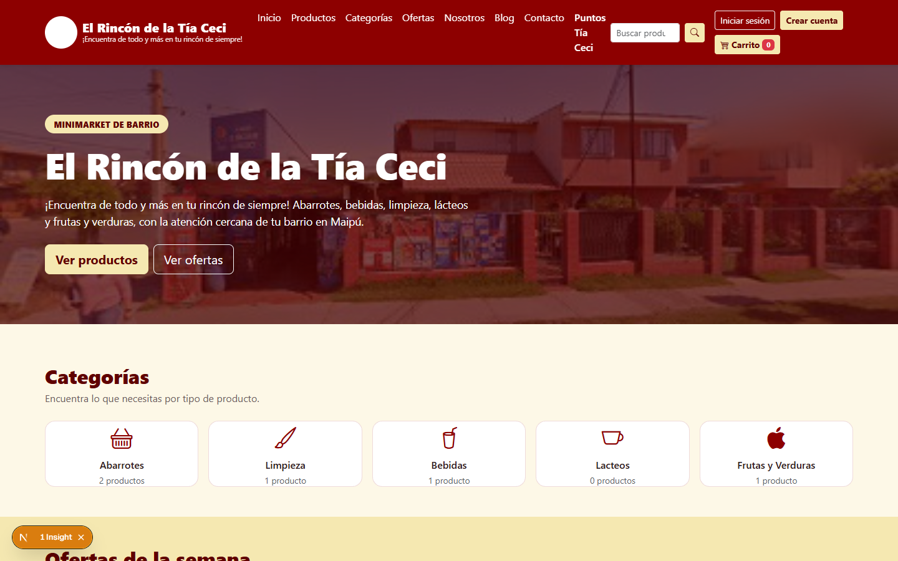

En la portada se ve la historia del minimarket, los productos recién llegados y
el mapa con la dirección. Desde el menú superior se llega a Productos,
Categorías, Ofertas, Nosotros, Blog, Contacto y Puntos.

Arriba a la derecha están los botones **Iniciar sesión** y **Crear cuenta**, y el
**carrito** con el número de productos agregados.

### 4.2 Catálogo de productos

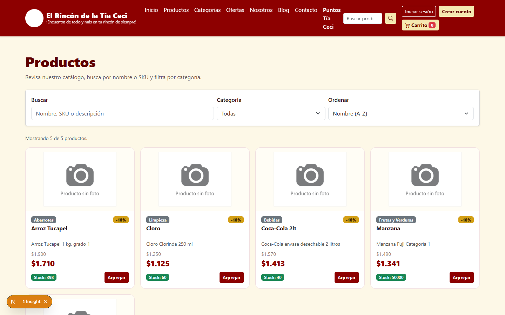

- Cada tarjeta muestra la categoría, el descuento (**-10 %**), el nombre, la
  descripción, el precio normal y el precio con oferta, además del **stock
  disponible**.
- El precio con oferta aparece en rojo y es un 10 % menos que el precio base.
- El bloque **Buscar** filtra por nombre, SKU o descripción; **Categoría** filtra
  por rubro y **Ordenar** permite ordenar por nombre o por precio.
- El botón **Agregar** suma el producto al carrito.

### 4.3 Carrito

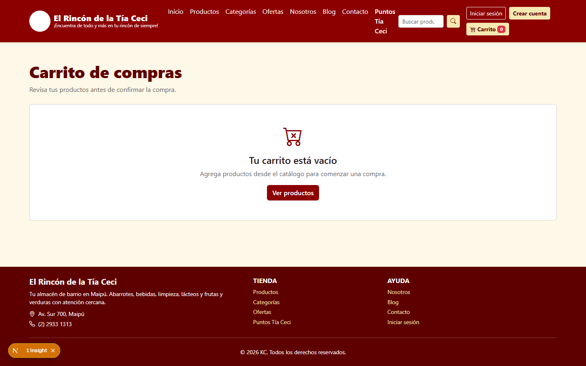

Aquí se revisan los productos, se cambian las cantidades o se quitan, y se ve el
subtotal con el descuento y el total a pagar.

### 4.4 Comprar

Al presionar **Ir a pagar** se abre el formulario de compra, donde se elige:

- **Entrega:** domicilio o retiro en el local.
- **Método de pago:** tarjeta de crédito, tarjeta de débito, efectivo o pago en
  línea.
- **Datos de contacto y dirección**, si es a domicilio.

Al confirmar, el backend registra la orden, descuenta el stock y procesa el pago.
Después se muestra la pantalla de compra exitosa con el número de orden.

### 4.5 Crear una cuenta

En `/crear-cuenta` un cliente nuevo se registra con sus datos personales, RUN,
correo y contraseña. El sistema valida el RUN con su dígito verificador, el
formato del correo y el teléfono. Al terminar, la sesión queda iniciada
automáticamente.

### 4.6 Iniciar sesión

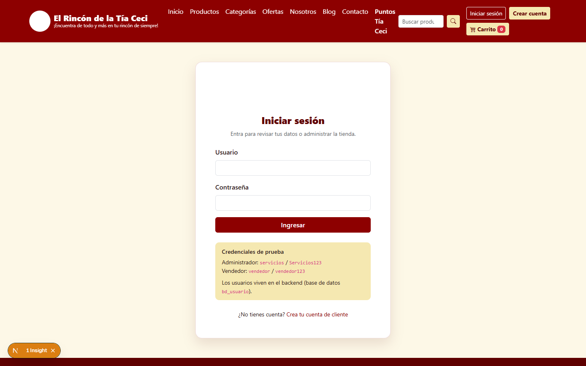

Se escribe el usuario y la contraseña. El sistema se los envía al backend, que
responde con un **token de acceso (JWT)** que incluye el rol del usuario.

- Si las credenciales son incorrectas, aparece **"Usuario o contraseña
  incorrectos"** y no se entra.
- Si son correctas, el Administrador y el Vendedor van al panel, y el Cliente
  vuelve a la tienda.

### 4.7 Otras secciones

- **Ofertas:** muestra solo los productos con descuento.
- **Categorías:** agrupa los productos por rubro.
- **Puntos Tía Ceci:** formulario para inscribirse en el programa de puntos, con
  validación de RUN, correo y nombres.
- **Blog, Nosotros y Contacto:** información del local y formulario de contacto.

---

## 5. El panel de administración

Se entra por `/admin` después de iniciar sesión con un rol autorizado.

### 5.1 Dashboard

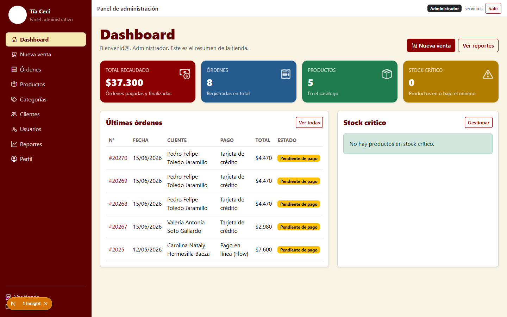

Muestra el resumen del negocio con datos reales:

- **Total recaudado** por las órdenes pagadas y finalizadas.
- **Órdenes** registradas en total.
- **Productos** en el catálogo.
- **Stock crítico:** productos en o bajo el mínimo.
- **Últimas órdenes** con número, fecha, cliente, método de pago, total y estado.
- **Stock crítico:** listado de productos que necesitan reposición.

### 5.2 Nueva venta (punto de venta)

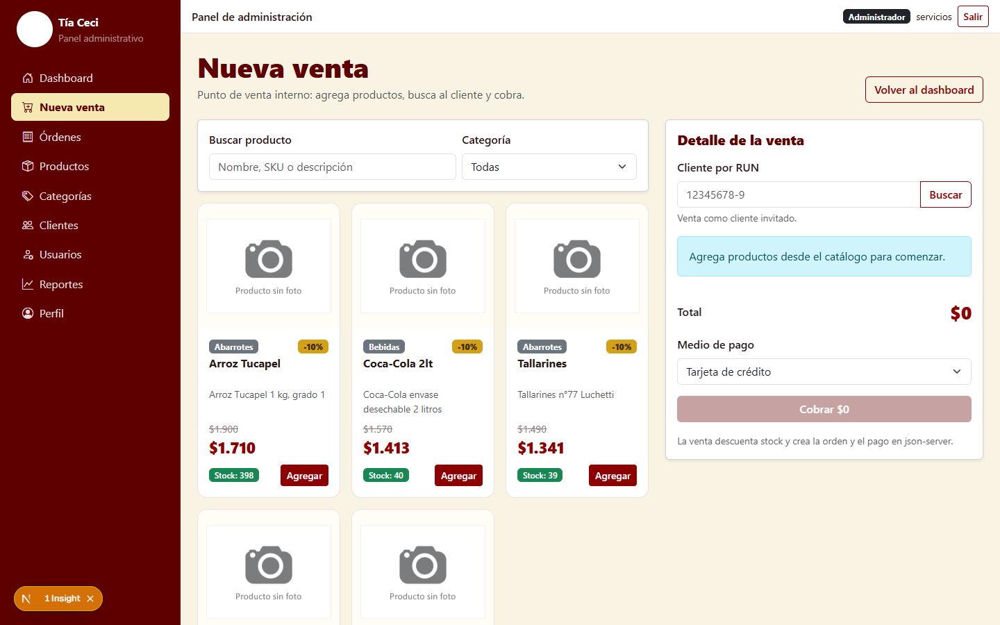

Es la pantalla que usa el cajero:

1. Buscar el producto por nombre o SKU (o tocar la tarjeta).
2. Se agrega solo al detalle de la venta.
3. Ajustar cantidades si hace falta.
4. Opcionalmente asociar un cliente por su RUN.
5. Elegir el método de pago y presionar **Cobrar**.

El monto total lo calcula el **backend** con el precio de su catálogo, y al
cobrar se descuenta el stock automáticamente.

### 5.3 Órdenes

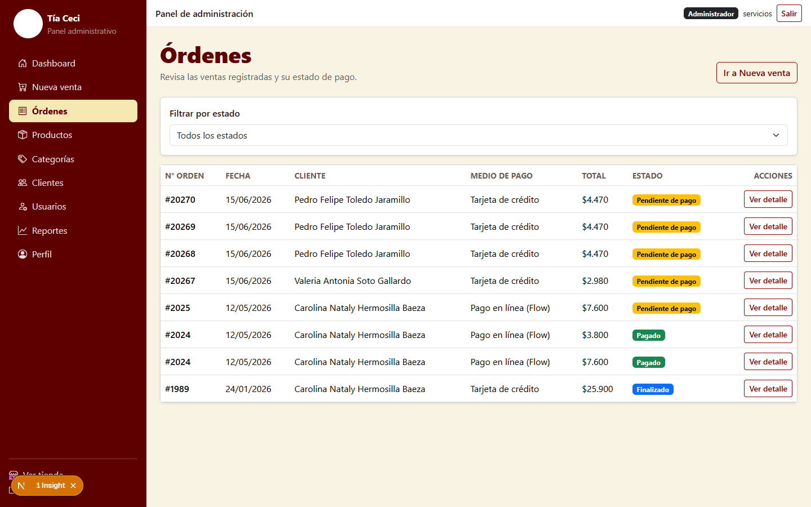

Lista todas las ventas con su número, fecha, cliente, total y estado. Desde cada
orden se puede ver el detalle y cambiar el estado a **PAGADO**, **FINALIZADO** o
**CANCELADO**.

> Si se anula una orden, el sistema **devuelve el stock** de cada producto
> vendido registrando un movimiento de entrada.

### 5.4 Productos

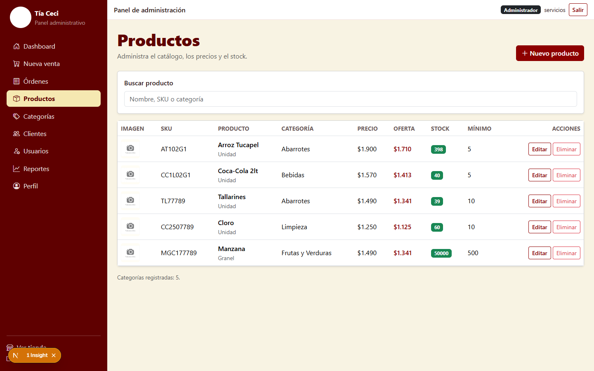

Permite crear, editar y eliminar productos. Al crear uno nuevo, el sistema
también crea su registro de stock inicial; al eliminarlo, borra ese stock.

### 5.5 Categorías

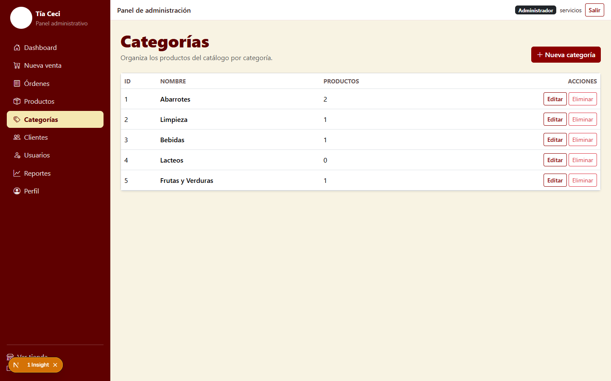

Alta, edición y borrado de las categorías del catálogo.

### 5.6 Clientes

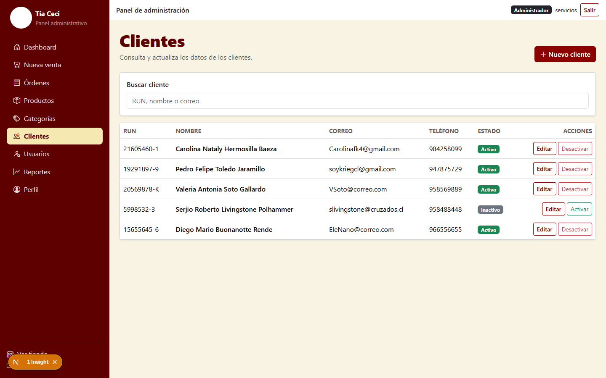

Listado de clientes con su RUN, nombre, contacto y estado (activo o inactivo).
Se pueden crear, editar, activar y desactivar.

### 5.7 Usuarios

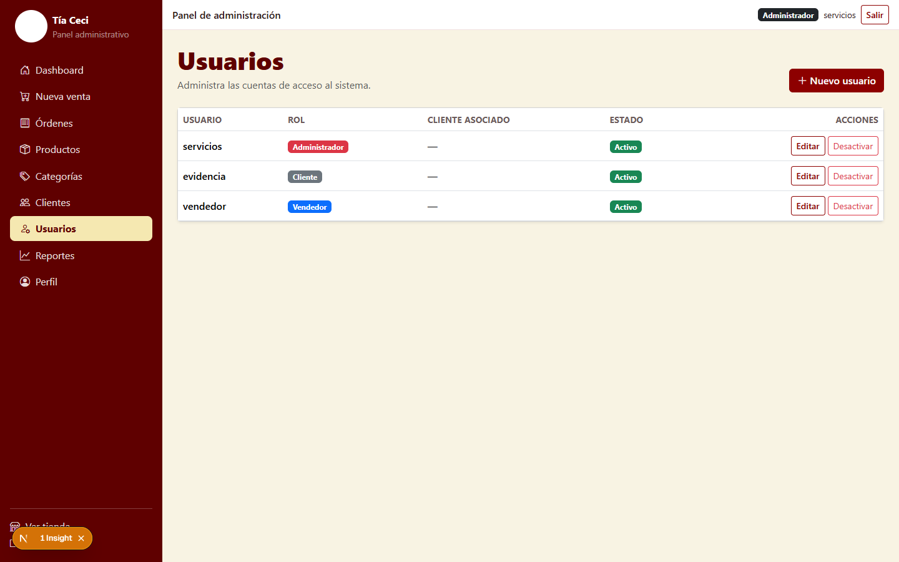

Solo la ve el Administrador. Permite crear cuentas y **asignarles un rol**:
Administrador, Vendedor o Cliente. La contraseña se guarda cifrada y nunca se
muestra. Al modificar un usuario se puede dejar la contraseña en blanco para no
cambiarla.

### 5.8 Reportes y Perfil

- **Reportes:** ventas por día y productos más vendidos.
- **Perfil:** datos de la cuenta con la que se entró.

---

## 6. Diferencias entre roles

El menú y las pantallas cambian según el rol. Esto **no** es solo visual: el
backend también rechaza las peticiones que no correspondan.

### 6.1 Menú del Vendedor

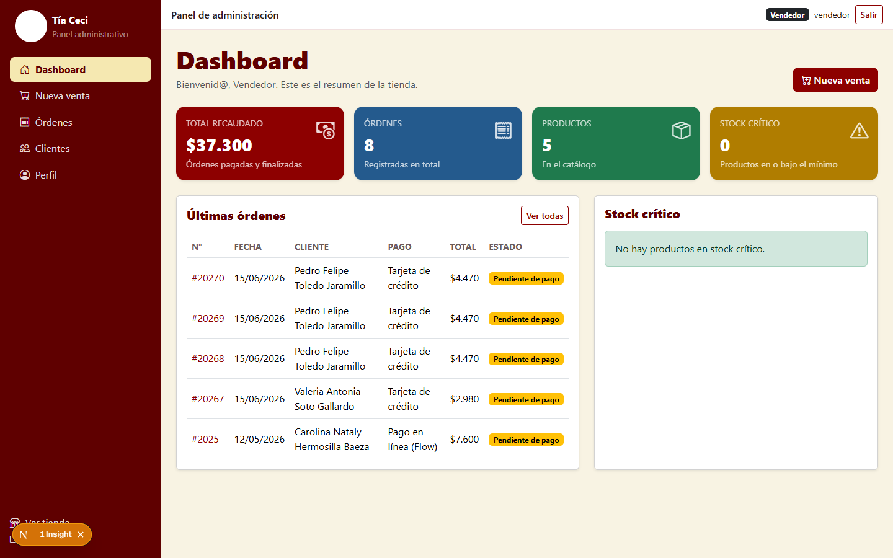

El Vendedor **no** ve Productos, Categorías, Clientes, Usuarios, Reportes ni
Perfil de administración. Solo tiene Dashboard, Nueva venta, Órdenes y lo
relacionado con el cobro.

### 6.2 Cuando el Vendedor intenta entrar a una sección restringida


Si escribe la dirección a mano (`/admin/productos`), la aplicación lo devuelve al
Dashboard. Y si intentara hacer la operación directamente contra la API con su
token, el gateway responde **403 (sin permiso)**.

### 6.3 Resumen

| Acción | Administrador | Vendedor | Cliente |
|---|:---:|:---:|:---:|
| Ver catálogo | Sí | Sí | Sí |
| Crear o editar productos y categorías | Sí | No | No |
| Registrar una venta | Sí | Sí | Sí |
| Ver clientes | Sí | Sí | No |
| Ver y administrar usuarios | Sí | No | No |
| Ver facturas, reportes y proveedores | Sí | No | No |
| Comprar en la tienda | Sí | Sí | Sí |

---

## 7. Uso en el celular

El sitio es responsivo: se adapta a celular, tablet y computador.

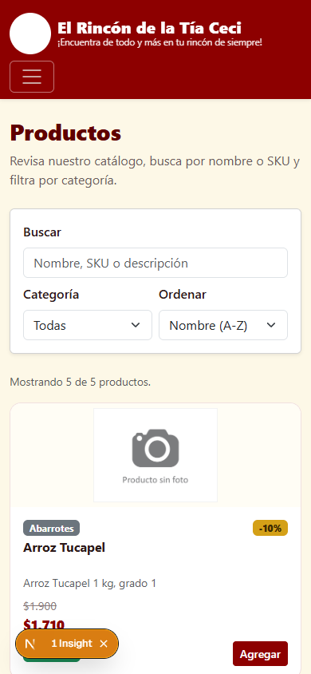

En pantallas chicas:

- El menú de la tienda se reparte en varias filas.
- Las tarjetas de producto se apilan.
- Las tablas del panel se desplazan de lado en vez de romper la página.
- El panel de administración reemplaza la barra lateral por un botón **☰ Menú**.

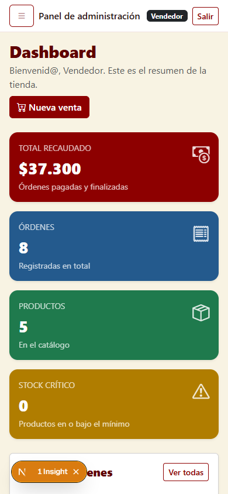

---

## 8. Problemas frecuentes

| Qué se ve | Qué significa | Qué hacer |
|---|---|---|
| "No se pudo conectar con la API. Revisa que el backend esté corriendo en el puerto 4425" | El backend está apagado | Ejecutar `iniciar-servicios.ps1` |
| "Usuario o contraseña incorrectos" | Los datos no coinciden con la base | Revisar mayúsculas y la contraseña; recordar el mínimo de 8 caracteres |
| "No tienes permiso para realizar esta acción" | El rol no alcanza para eso | Entrar con un usuario Administrador |
| "Tu sesión expiró…" | El token dura 2 horas | Volver a iniciar sesión |
| La página queda en "Verificando sesión…" | El navegador bloquea el almacenamiento local | Permitir `localStorage` para el sitio |
| Los productos aparecen con "Producto sin foto" | El backend no guarda imágenes de producto | Es lo esperado; se usa una imagen genérica |

---

## 9. Cómo cerrar sesión

En el panel, arriba a la derecha, está el botón **Salir**. Borra la sesión y el
token del navegador y devuelve a la tienda.
